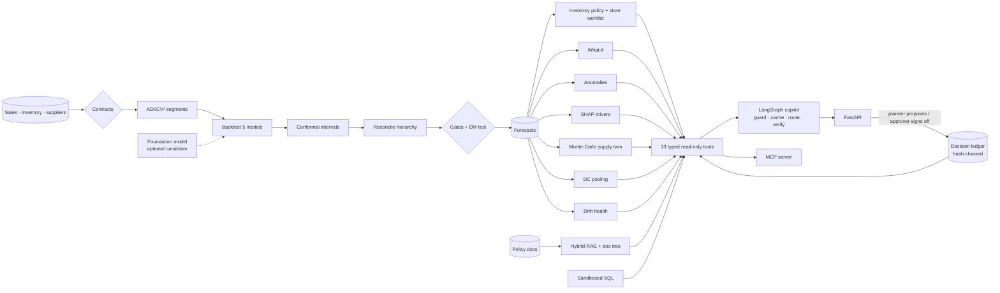

# Kairos

**Supply-chain decision intelligence**: probabilistic demand forecasting →
inventory policy → a grounded AI copilot that planners can trust.

> "Should we reorder SKU002 at S01?"
> → *Reorder point 432, safety stock 153, inventory position 371 → order 520 units. Stockout probability 16%.*
> Every number traced to a tool call, a model run id and a data fingerprint.



## Results (default synthetic dataset, reproducible)

| | Value |
|---|---|
| Champion | LightGBM (Tweedie, global, horizon-safe features) |
| WAPE / MASE / bias | 0.324 / 0.726 / −0.1% (seasonal naive: 0.53 / 1.14) |
| 80% interval coverage (held-out fold) | 82.8% |
| Anomaly detector P / R | 0.77 / 0.62 vs injected ground truth |
| Copilot eval gate (36 cases) | tool F1 1.00 · correctness 1.00 · grounding 1.00 · security 1.00 |
| Engineering | 105 tests · ruff + mypy clean · Docker smoke test passes |

## Quick start

```bash
make setup
make seed train
make ask Q="What is the forecast for S01 SKU002 next week?"
make ask Q="Stress test S01 SKU002: what happens if the supplier is delayed 7 days?"
make serve            # http://localhost:8000/docs   (X-API-Key: dev-key)
make check            # lint + types + tests + eval gate
```

Real model: `export KAIROS_LLM_PROVIDER=anthropic KAIROS_ANTHROPIC_API_KEY=...`.
Foundation model candidate: `pip install -e '.[foundation]'` then `KAIROS_FOUNDATION_MODEL=chronos make train`.
Human sign-off: `POST /v1/decisions/proposals` (planner key) → `POST /v1/decisions/proposals/{id}/approve`
(`X-API-Key: dev-approver-key`) → `GET /v1/decisions/audit/verify`.
MCP: `claude mcp add kairos -- $(pwd)/.venv/bin/kairos mcp`.
Full stack with Prometheus + Grafana: `make up`.

## What's inside

| Area | Highlights |
|---|---|
| Forecasting | Data-driven ADI/CV² demand segmentation (Syntetos–Boylan) · seasonal naive, damped ETS, Croston-TSB, LightGBM Tweedie, ensemble · rolling-origin backtest · per-segment selection · split-conformal intervals per horizon week · WLS hierarchical reconciliation · censored-demand handling · leakage test · per-forecast SHAP driver explanations (LightGBM TreeSHAP) |
| Decision intelligence (v2) | **Monte-Carlo supply twin**: stress-test the policy under supplier delay / demand shock – fill rate, lost units, chance of a stockout day, distribution-free reorder point and order-now qty · **two-echelon DC pooling** with measured cross-store correlation, break-even DC leg and a plain verdict · **human sign-off ledger**: planner proposes, a different approver signs off (four-eyes), SHA-256 hash-chained audit, realised outcomes → evidence-backed **lessons** and override value-add · **calibrated drift health** (PSI vs per-series noise floor + significant level shift) · **PageIndex-style doc tree** for navigating policies · optional **foundation-model** (Chronos-Bolt) candidate that must win the same backtest + gates |
| Decisions | Store reorder worklist ranked by stockout risk · safety stock with demand **and** lead-time variance · ROP · EOQ/MOQ · stockout probability · service-level cost curve · promo what-if with post-promo dip · explainable anomaly detection with cause attribution |
| MLOps | Data contracts · registry with atomic runs · champion/challenger gates on identical folds + Diebold–Mariano significance test · feature schema saved with the model (train/serve skew guard) · rollback that re-serves the old run's forecasts · MLflow mirror · batch-train/read-serve split |
| Copilot | LangGraph state machine · Claude (Opus 5.5 strong / Haiku 5.5 fast) with prompt caching, effort control, refusal fallback · hybrid BM25+dense RAG with RRF · text-to-SQL sandbox (AST guard + function allow-list + locked engine + query timeout) · numeric grounding verifier · semantic cache keyed on model version, planner preferences and exact entities · per-session memory + preferences (never shared across planners) · degraded mode · SSE streaming |
| Safety | Direct + indirect prompt-injection defence (poisoned doc in corpus) · PII redaction · read-only tools · weighted rate limits · admin-only retrain/rollback keys |
| Evals | 28-case golden set with live-SQL ground truth · CI gate · nightly real-model run · RAGAS export |
| Ops | FastAPI · MCP server · Prometheus metrics · JSON traces · Docker (non-root) · compose · K8s (HPA + training CronJob) · GitHub Actions |

## Docs

Start at [docs/README.md](docs/README.md): plan, requirements, system design
(architecture, forecasting, inventory, agent, RAG, API, scaling, security,
observability, failure modes), tech stack, 22 ADRs, evaluation, runbooks,
step-by-step build guide, and interview notes. Contributor/agent rules:
[CLAUDE.md](CLAUDE.md).

Data is synthetic by design (client data is confidential); the generator
encodes the pathologies real retail data has – see
[data model and flow](docs/03-system-design/data-model-and-flow.md).
