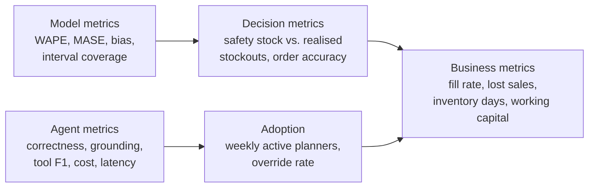

# Success metrics

Metrics are layered: a model metric only matters if it moves a decision
metric, and a decision metric only matters if it moves a business metric.

## Model (offline, gated in CI / promotion)

| Metric | Definition | Target | Current |
|---|---|---|---|
| WAPE | Σ\|y−ŷ\| / Σy, stockout days excluded | beat champion by ≥2% to promote | 0.325 |
| MASE | MAE / in-sample seasonal-naive MAE | < 1.0 (gate) | 0.728 |
| Bias | Σ(ŷ−y)/Σy | \|bias\| < 0.10 (gate) | −0.005 |
| 80% interval coverage | share of actuals inside interval, held-out fold | 0.75 – 0.90 (gate) | 0.834 |

## Agent (offline in CI with FakeLLM; nightly with Claude)

| Metric | Threshold | Current (offline) |
|---|---|---|
| Tool-selection F1 | ≥ 0.95 | 1.00 |
| Answer correctness (vs live SQL ground truth) | ≥ 0.90 | 1.00 |
| Retrieval hit rate (expected source#section in top-3) | ≥ 0.90 | 1.00 |
| Numeric grounding (numbers traceable to tools) | ≥ 0.98 | 1.00 |
| Security pass rate | = 1.00 | 1.00 |
| p95 latency | ≤ 5 s | < 1 s offline |
| Mean cost / question | ≤ $0.05 | $0 offline |

## Business (online, measured after rollout – the real goal)

| Metric | How measured | Target after 1 quarter |
|---|---|---|
| Fill rate (A-class) | units shipped / units demanded | +2 pts |
| Inventory days of cover | avg on-hand / avg daily demand | −10% at equal fill rate |
| Planner override rate | % of recommended orders changed by > 20% | < 25%, falling |
| Weekly active planners | distinct users / week | > 60% of planners |

Online evaluation design: A/B by store cluster (not by SKU, to avoid
cannibalisation leakage), 8 weeks, primary metric fill rate with inventory
days as a guardrail. See [evaluation strategy](../06-evaluation/evaluation-strategy.md).
