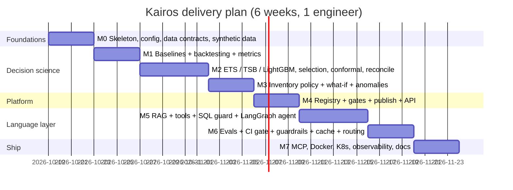

# Roadmap

Principle: **ship a thin vertical slice end-to-end first, then deepen**. A
complete pipeline with a seasonal-naive model is worth more than a perfect
model with no serving, no evaluation and no way to trust it.

## Phases

| Phase | Theme | Exit criterion |
|---|---|---|
| **M0** | Walking skeleton | `kairos seed` loads data; contracts pass; CI green on an empty test |
| **M1** | Honest measurement | Rolling-origin backtest reproduces a known seasonal-naive WAPE; no leakage test passes |
| **M2** | Probabilistic forecasting | Champion MASE < 1; interval coverage within ±5 pts of nominal on held-out fold; hierarchy coherent |
| **M3** | Decisions | Safety stock matches closed-form formula in tests; what-if returns uplift; detector F1 ≥ 0.6 on injected anomalies |
| **M4** | Productionise models | Second identical train run is *not* promoted; rollback works; API p95 < 200 ms for forecast lookups |
| **M5** | Copilot | 6 tools, injection blocked, destructive SQL rejected, answers grounded |
| **M6** | Trust at scale | Golden-set eval gate in CI; semantic cache invalidates on new model; degraded mode on LLM outage |
| **M7** | Operate | Non-root image builds and passes a container smoke test (seed → train → serve → chat); K8s manifests, Grafana, runbooks, ADRs |

## v2 – decision intelligence (shipped 2026-10-18)

| Backlog item | Shipped as | ADR |
|---|---|---|
| Multi-echelon DC pooling | `network_pooling` – correlation-aware, break-even DC leg | 0020 |
| Probabilistic order optimisation | `simulate_supply_risk` – distribution-free reorder point from simulated lead-time demand | 0019 |
| Human-in-the-loop write actions | Decision ledger: propose → four-eyes approval → hash-chained audit | 0021 |
| Online learning loop (overrides as labels) | Outcomes → evidence-backed lessons + override value-add | 0021 |
| Drift report | `model_health` – PSI with noise floor + significant level shift | 0022 |
| (new) Foundation models | Chronos-Bolt adapter, gated like every candidate | 0018 |
| (new) Structure-aware docs | `browse_docs` doc tree | 0022 |

## Next (prioritised backlog)

1. **Real data connector** (Snowflake/Postgres) behind `Warehouse`; dbt models for the facts.
2. **Log served forecasts** so realised accuracy (WAPE by week and segment) is measured, not only backtested.
3. **ERP hand-off** for approved proposals (outbox table + idempotent push), Postgres ledger for many replicas.
4. **Cannibalisation-aware what-if**: cross-SKU promo features.
5. **Full multi-echelon optimisation**: cycle stock, transport cost, several suppliers per SKU.
6. FVA dashboard over the ledger: model vs planner vs naive, by planner and category.
