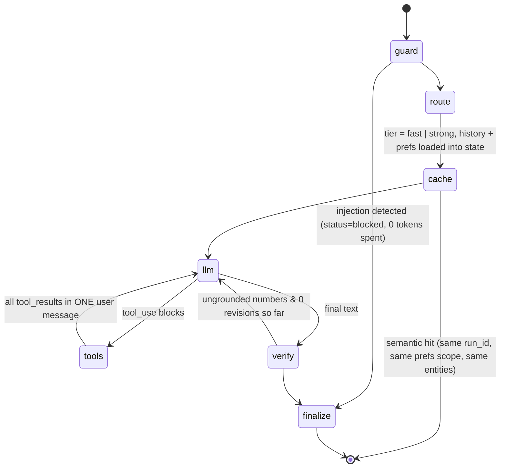

# Copilot (agent) design

Code: `src/kairos/agent/`, `src/kairos/llm/`.

## Principle

> **The LLM decides *which* tools to call and how to explain the result.
> Code decides what is *allowed*, what is *true*, and when to *stop*.**

## Graph

| Node | Responsibility | Why it is a separate node |
|---|---|---|
| guard | Regex screening for instruction override / prompt extraction | Reject before spending tokens; testable in isolation |
| route | Pick model tier; load session history and preferences into state | Cost control; keeps system prompt byte-stable; prefs never touch shared context (ADR-0016) |
| cache | Semantic lookup keyed by `run_id` + prefs scope + exact ids/numbers | Skip LLM for repeated questions without ever crossing planners or SKUs |
| llm | One model call; enforces step & token budget | Budget is a code invariant, not a prompt request |
| tools | Validate (pydantic) and run tool calls in parallel on a per-request context copy | Errors become `is_error` results the model can recover from |
| verify | Numeric grounding; one revision with feedback | Hallucinated numbers are the most dangerous failure |
| finalize | Citations, warning banner (memory + cache write in `_finish`, shared by `ask` and `stream`) | Post-conditions in one place |

## Tools

| Tool | Answers | Safety |
|---|---|---|
| `get_forecast` | "How much will we sell?" Weekly summary + interval + run_id | Ids validated by regex; horizon clamped |
| `inventory_policy` | "Should we order? How much?" | Service level bounded [0.5, 1) |
| `what_if_promo` | "What if we run a promo?" | Days ≤ 14; date clamped to horizon |
| `detect_anomalies` | "Anything unusual?" | 180-day window, top-k ≤ 20 |
| `explain_forecast` | "Why is the forecast this?" Baseline + % effect per driver (LightGBM TreeSHAP) | Read-only; reports which model it explains vs serves |
| `reorder_worklist` | "What do I reorder at S01?" All SKUs ranked by stockout risk | top-k ≤ 50; same policy math as `inventory_policy` |
| `run_sql` | Ad-hoc aggregates | AST guard + function allow-list + locked engine + timeout (ADR-0015) |
| `search_docs` | Rules, targets, penalties | Sanitised, untrusted flag, citations |

Tool outputs are **compact by design**: the forecast tool returns 4 weekly
rows, not 28 daily rows. The model pays for every token it reads; fewer
tokens also mean fewer places to misread a number.

One registry (`agent/tools.py::TOOLS`) generates Claude tool definitions and
backs the MCP server, so validation, guards and metrics are identical across
channels (ADR-0002). Definitions are emitted in sorted order so the tool
block is byte-stable for prompt caching.

## Model routing and cost

| Tier | Model | Effort | Used for |
|---|---|---|---|
| fast | `claude-haiku-5-5` | low | Single-entity lookups ("forecast S01 SKU002") |
| strong | `claude-opus-5-5` | high | why / should / compare / what-if / plan, > 2 entities, long questions |

Cost levers, cheapest first: semantic cache (no call) → prompt caching on
the frozen system prompt + tool list (cache reads ~0.1× input price) →
fast tier for lookups → compact tool payloads → step/token budget. Per-call
cost is computed from usage and exported as `kairos_llm_cost_usd_total`.

## Claude API specifics (current API, verified)

* Thinking is adaptive and always on for the current models; depth is
  controlled with `output_config.effort`, not a token budget.
* Forced `tool_choice` (`any` / `tool`) is rejected on the current strong
  models → we use `auto` and steer via the system prompt.
* Inside a tool loop the full `response.content` (including thinking blocks)
  is appended back unchanged as the assistant turn.
* Strong tier enables the **server-side refusal fallback**
  (`betas=["server-side-fallback-2026-07-01"]`, `fallbacks="default"`): if
  the model declines on policy grounds, the API re-runs on a fallback model in
  the same call. `stop_reason == "refusal"` is still handled.
* Typed error chain: `BadRequestError` → bug (no retry); auth/rate-limit/5xx/
  connection → `LLMUnavailable` → degraded mode. SDK retries (3) run first.

## Grounding verifier

Extract every number > 31 from the answer (smaller numbers are mostly days,
ranks, percentages restated from the question), strip ids and dates, and
match each against all numbers in tool outputs and the question (±2%
relative or ±0.5 absolute, and ×100 / ÷100 for percentages). Any miss →
one revision with explicit feedback listing the bad numbers. Still failing
→ answer is returned with a visible warning, the cache is **not** written,
and the eval metric drops.

## Memory

* Short-term: last 6 turns as plain question/answer text (never raw tool
  payloads – they bloat context and go stale).
* Preferences: deterministic extraction ("our target service level is 98%")
  stored per session and applied as tool defaults.
* Preferences are injected in the *user* turn, not the system prompt, so the
  cached prefix never changes.

## Failure handling

| Failure | Behaviour |
|---|---|
| LLM unavailable | Degraded: plan tools deterministically, answer from tool results, status `degraded` |
| Model loops on tools | Step budget → final call with no tools → status `budget_exhausted` |
| Invalid tool args | `is_error` result with pydantic messages; model retries |
| Tool raises | `internal tool error: <Type>`; conversation continues |
| Unsafe SQL | `query rejected by SQL guard: …` |
| No champion | `NotReady` → 503 on API / `is_error` in agent |

## Why not a multi-agent system?

The task is a short tool loop over 6 well-scoped tools. A planner/worker
split would add latency, cost and failure modes without adding capability.
Multi-agent would earn its place for long research tasks (e.g. "audit all
428 SKUs for excess stock and draft a report"), which is on the roadmap as a
batch job, not a chat feature.
