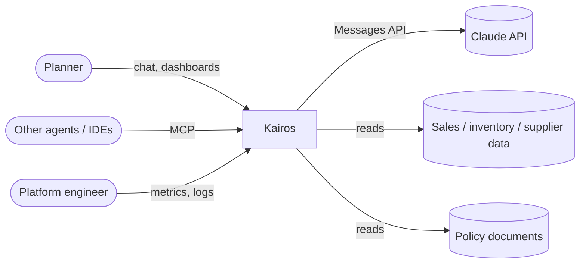
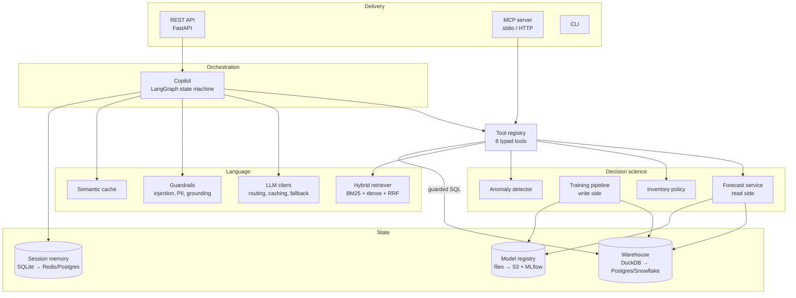
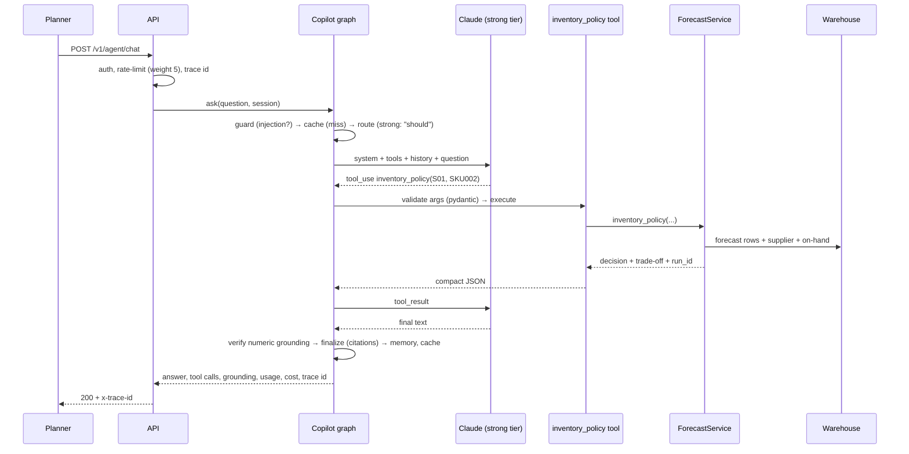

# Architecture

## Context (C4 level 1)



## Containers (C4 level 2)



## Layering rule

Dependencies only point **down**. Enforced by review and by the package
layout (`kairos/__init__.py` documents it).

```
delivery      api · mcp_server · cli
orchestration agent
language      llm · rag
decision      forecasting · inventory · anomaly
data          data
cross-cutting config · observability · bootstrap (composition root)
```

`bootstrap.build()` is the **composition root**: the only place that picks
concrete classes. API, MCP, CLI and tests all call it, so they cannot drift.

## Key architectural decisions (summary)

| Concern | Decision | ADR |
|---|---|---|
| Forecast serving | CQRS split: batch training writes `fact_forecast`; API only reads | [0007](../05-decisions/0007-batch-train-online-serve.md) |
| Uncertainty | Split-conformal intervals on any point model | [0006](../05-decisions/0006-conformal-intervals.md) |
| Features | Horizon-safe lags, direct multi-horizon model | [0005](../05-decisions/0005-horizon-safe-direct-forecasting.md) |
| Censored demand | Mask stockout days in targets, features and metrics | [0004](../05-decisions/0004-censored-demand.md) |
| Agent control | Explicit LangGraph state machine, not free ReAct | [0012](../05-decisions/0012-explicit-agent-graph-read-only-tools.md) |
| CI for LLM | Deterministic FakeLLM gate on every PR, real model nightly | [0010](../05-decisions/0010-offline-eval-gate-fake-llm.md) |
| Retrieval | Hybrid BM25 + dense with RRF | [0011](../05-decisions/0011-hybrid-retrieval.md) |
| Interop | Single tool registry for agent, MCP and API | [0002](../05-decisions/0002-single-tool-registry-mcp.md) |

## Request lifecycle: "Should we reorder SKU002 at S01?"


