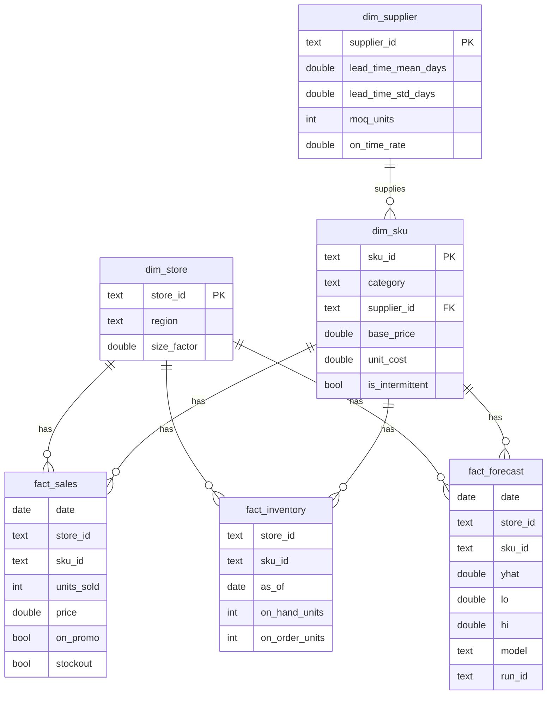
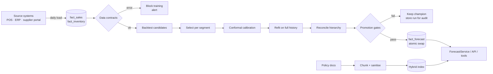

# Data model and data flow

## Star schema

Plus `fact_forecast_hierarchy(date, node, yhat, run_id)` with nodes `total`,
`store:<id>`, `<store>|<sku>`.

**Grain matters.** `fact_sales` is one row per day × store × SKU. Contracts
enforce uniqueness and no calendar gaps, because a missing day silently shifts
every lag feature by one.

## Flow

## Synthetic data: what each pathology tests

| Pathology in generator | Breaks naïve systems by… | Handled in |
|---|---|---|
| Weekly + yearly seasonality, trend | Moving averages lag | ETS, GBM calendar features |
| Moving festival (Diwali) | 365-day lag misaligns | `festival` feature |
| Promotions + post-promo dip | Over-forecast after promo | `on_promo`, `promo_ended_3d` |
| Price inflation step + elasticity | Level shift looks like trend | `price_ratio` |
| Negative-binomial noise | Gaussian assumptions | Tweedie objective, conformal |
| **Stockout censoring** | Learns empty shelf = low demand | Masking (ADR-0004) |
| Intermittent SKUs | MAPE undefined, ETS over-forecasts | Segment selection, TSB |
| Point anomalies (labelled) | Contaminate training, false alerts | Robust detector, eval vs truth |
| Supplier lead-time variance | Under-stocked unreliable suppliers | Combined-variance safety stock |

## Data versioning

Every training run records a SHA-256 fingerprint of the sales table, row
count and date range in `manifest.json`. Two runs with the same fingerprint
and code produce identical metrics (seeded). In production, swap the
fingerprint for a table snapshot id (Snowflake time travel / Delta version).
