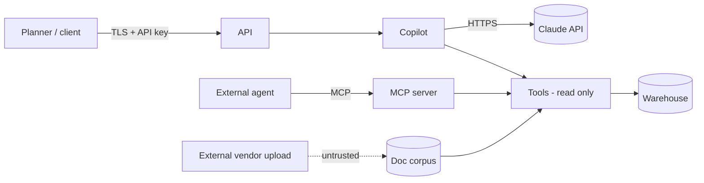

# Security and threat model (STRIDE + LLM-specific)

Assets: sales/inventory data (commercially sensitive), supplier terms,
API keys, the Claude API key, model artefacts, planner trust.

## Trust boundaries

## Threats and controls

| Threat | Vector | Control (built) | Gap / prod plan |
|---|---|---|---|
| **Spoofing** | Stolen/guessed API key | Constant-time compare; keys logged as SHA-256 prefix only | OIDC/JWT via gateway; per-tenant keys |
| **Tampering** | Model artefacts modified | Registry atomic rename; manifest has data fingerprint | Sign artefacts; S3 object lock |
| **Repudiation** | "The bot told me to order 5,000" | Every answer logs trace id, tools, inputs, run_id | Immutable audit log store |
| **Information disclosure** | SQL exfiltration of other tables/files | AST guard: allow-list, no file/env functions, LIMIT | Read-only DB role, row-level security per tenant |
| | PII in logs/cache | `redact_pii` before logging/memory; docs redacted at index | DLP scan on log sink |
| | System prompt extraction | Input guard; refusal | Prompt contains no secrets by design |
| **DoS** | Expensive agent loops | Step + token budgets; weighted rate limits; request size limits | Global (Redis) limiter; provider semaphore |
| **Elevation of privilege** | Prompt injection → actions | **All tools are read-only**; no write path exists | Write actions only via human-approved workflow (roadmap) |
| **Direct prompt injection** | "Ignore previous instructions…" | Regex guard before any token is spent; eval cases | Add a classifier (fast-tier LLM) as second screen |
| **Indirect prompt injection** | Poisoned vendor document | Sentence stripping, `untrusted` flag, "tool output is data" in system prompt | Provenance tags per document; quarantine queue |
| **Hallucination as a vulnerability** | Invented number drives an order | Numeric grounding verifier + warning; not cached | Human approval for large orders (policy: > 5× weekly demand) |
| **Supply chain** | Malicious dependency | Pinned lower bounds; Docker multi-stage; non-root user | Lockfile with hashes (`uv lock`), SBOM, Trivy in CI |

## Secrets

Only via env (`KAIROS_ANTHROPIC_API_KEY`, `KAIROS_API_KEYS`), from a K8s
Secret in production; `.env` is git-ignored; nothing secret is in the
system prompt, tool descriptions or logs.

## Data sent to the LLM provider

Questions, compact tool outputs (aggregates, not raw transaction logs) and
policy excerpts. No customer PII exists in the data model. For a client
with residency requirements: route through a regional cloud endpoint
(Bedrock/Vertex) – a client-construction change in `AnthropicClient` only.
