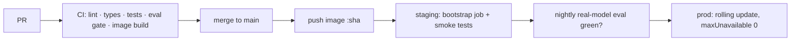

# Runbook: deployment

## Artefacts
One image (`Dockerfile`) runs every role: API (`kairos serve`), training
job (`kairos train`), MCP server (`kairos mcp`), eval (`kairos eval`).

## Release flow



Model releases are **not** code releases: the weekly CronJob trains and the
registry gates decide promotion. A code deploy never changes the champion.

## Kubernetes

```bash
kubectl create secret generic kairos-secrets \
  --from-literal=KAIROS_ANTHROPIC_API_KEY=... \
  --from-literal=KAIROS_API_KEYS='["key-1","key-2"]'
kubectl apply -f infra/k8s/kairos.yaml
kubectl create job --from=cronjob/kairos-train kairos-train-now   # first champion
kubectl rollout status deploy/kairos-api
```

Readiness gates on `/readyz` (champion exists), so pods join the load
balancer only when they can serve.

## Smoke test (staging and after every deploy)

```bash
curl -fsS $URL/healthz
curl -fsS $URL/readyz
curl -fsS -H "X-API-Key: $KEY" "$URL/v1/forecast/S01/SKU002?horizon_days=7"
curl -fsS -H "X-API-Key: $KEY" -H 'content-type: application/json' \
  -d '{"message":"Should we reorder SKU002 at S01?"}' $URL/v1/agent/chat
```

## Rollback

| What | How | Time |
|---|---|---|
| Bad model | `kubectl exec deploy/kairos-api -- kairos rollback` (pointer swap; pods hot-reload) | seconds |
| Bad code | `kubectl rollout undo deploy/kairos-api` | ~1 min |
